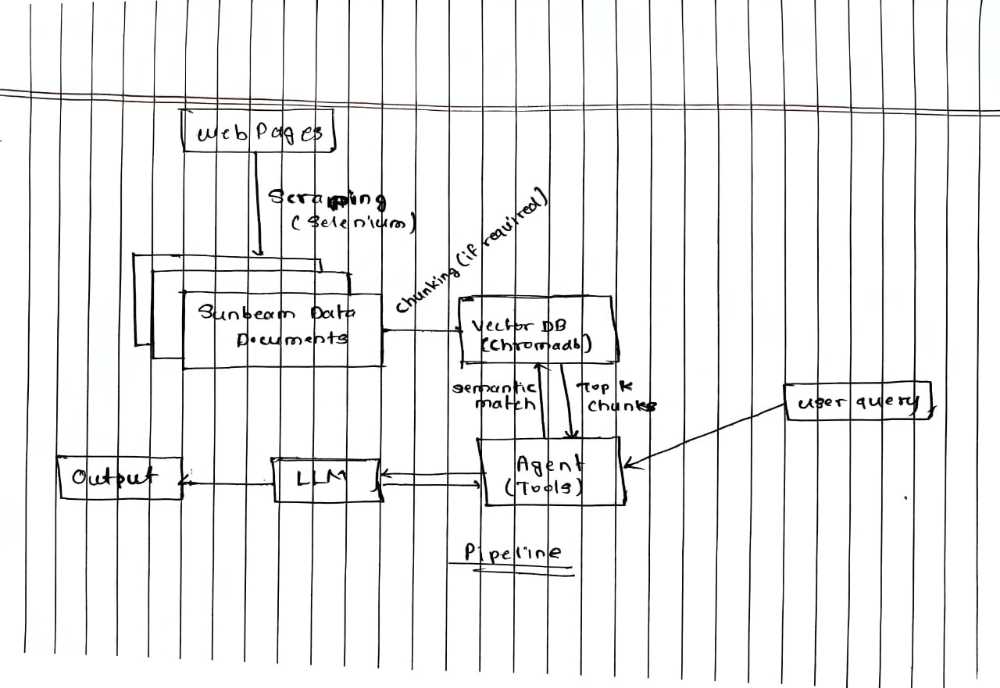
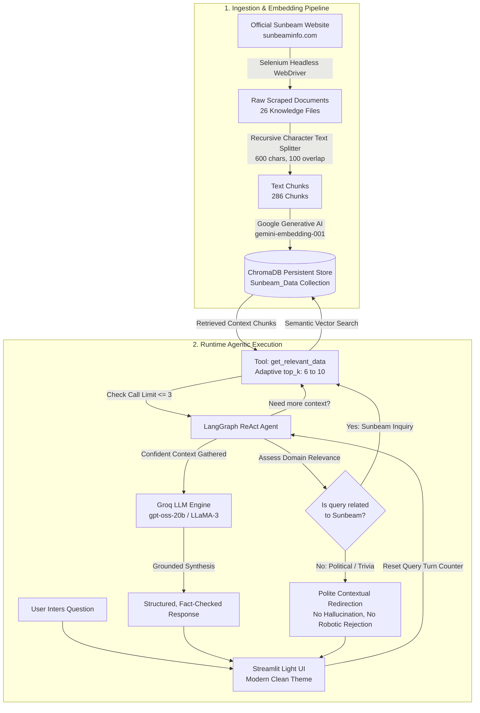

# ☀️ Sunbeam AI Assistant — Agentic RAG Platform

> An intelligent, production-ready **Agentic RAG (Retrieval-Augmented Generation)** assistant built for [Sunbeam Institute of Information Technology](https://www.sunbeaminfo.com/). Powered by **LangGraph**, **ChromaDB**, **Google Generative AI Embeddings**, and **Streamlit**.

---

## 📖 Table of Contents
- [Overview](#-overview)
- [System Architecture](#-system-architecture)
- [Key Features](#-key-features)
- [Project Structure](#-project-structure)
- [Technology Stack](#-technology-stack)
- [Step-by-Step Setup Guide](#-step-by-step-setup-guide)
- [How to Use the Assistant](#-how-to-use-the-assistant)
- [Knowledge Base & Scraping Workflow](#-knowledge-base--scraping-workflow)
- [Deployment Guide](#-deployment-guide)

---

## 🌟 Overview

The **Sunbeam AI Assistant** is an agentic conversational system designed to provide verified, authoritative, and grounded answers about Sunbeam Infotech. Rather than relying on static or hallucinated model knowledge, the system connects directly to a vector store containing data scraped from the official Sunbeam website ([https://www.sunbeaminfo.com/](https://www.sunbeaminfo.com/)).

The agent handles inquiries about:
- **C-DAC PG Diploma Programs** (1200 Hours each): PGCP-AC (DAC), PGCP-BDA (DBDA), PGCP-ESD (DESD), PGCP-ITISS (DITISS), and PGCP-MC (DMC) with modules, eligibility, and curriculum.
- **Specialized & Modular Courses**: Generative AI, Machine Learning, Python, Core Java, PySpark Data Engineering, DevOps, MERN Stack, and C++.
- **Campuses & Facilities**: Hinjawadi IT Park Phase 2 (Pune) and Karad (Satara) campuses, computer labs, digital library, and hostel accommodation details.
- **Placements & Career Records**: Batch-wise placement rates (DAC 94%, DBDA 93%, overall 89% across 36 batches) and recruiting partners.
- **Admissions & Financial Aid**: C-DAC CCAT exam preparation, batch timings, and educational loan assistance.

---

## 🏗️ System Architecture

The project follows a multi-tier **Agentic RAG Pipeline** designed for high precision, factual grounding, and self-correcting retrieval:



### Architecture Workflow (Mermaid Diagram)



### Core Architecture Components:

1. **Automated Selenium Web Scraper**: Navigates dynamic React/JavaScript single-page applications, expands accordion menus (Overview, Syllabus, FAQs, Branches), and produces structured markdown knowledge files.
2. **Chunking & Vector Store Layer**: Splits documents with `RecursiveCharacterTextSplitter`, generates dense semantic vector representations via `gemini-embedding-001`, and persists them in **ChromaDB**.
3. **Agentic ReAct Loop**: Built with **LangGraph**; evaluates relevance, formulates search queries, invokes the retrieval tool, inspects returned passages, and can refine its search up to a maximum limit of **3 calls per question**.
4. **Grounded Synthesis**: Follows strict anti-hallucination prompt boundaries; facts, numbers, dates, and contact information must be verified by the knowledge base.
5. **Modern Light UI**: Built with **Streamlit**, featuring custom CSS, brand styling, card-based navigation, and zero-login friction for immediate user interaction.

---

## 🌟 Key Features

- **☀️ Modern Light Theme Design**: Polished aesthetic with warm Sunbeam amber accents (`#E65100`), clean typography (*Plus Jakarta Sans*), and responsive layout.
- **🚀 Instant Access**: No login barriers or passwords; users can immediately start asking questions or click preset prompt cards.
- **🔄 Multi-Step Self-Correcting Search**: The agent evaluates whether its initial retrieval contains enough depth and can re-query with modified keywords or a higher `top_k` (up to 10).
- **🛡️ Guardrails & Tool Limiting**: Enforces a strict cap of **3 tool calls per query turn**, preventing runaway loops and reducing API latency.
- **🎯 Domain Boundary Intelligence**:
  - Out-of-scope trivia and political questions (e.g., *"Who is PM of India?"*) are politely redirected rather than generating external trivia or answering with robotic rejections.
  - General technology questions (e.g., *"How can I become a Data Scientist?"*) are actively connected to relevant Sunbeam programs (like PGCP-BDA / DBDA).
- **💬 Multi-Turn Session History**: Maintains conversation history within each chat session and supports creating multiple conversations from the sidebar.

---

## 📁 Project Structure

```
├── app.py                         # Main Streamlit web application (Light Theme)
├── config.py                      # Centralized configuration (paths, models, constants)
├── requirements.txt               # Project dependencies (LangGraph, ChromaDB, Selenium)
├── .env                           # Environment variables (API keys - not committed)
├── .gitignore                     # Git ignore rules (.env, venv, caches)
│
├── agent/                         # Agentic RAG core logic
│   ├── agent.py                   # LangGraph ReAct agent factory
│   ├── tools.py                   # get_relevant_data retrieval tool with call limiter
│   └── prompts.py                 # Grounded system prompt & boundary instructions
│
├── vector_store/                  # Vector database abstraction
│   └── chroma_client.py           # Persistent ChromaDB client & semantic search
│
├── data/
│   └── knowledge_base/            # ChromaDB database (286 embedded chunks)
│
├── scraping/                      # Web scraping engine
│   ├── scrape_sunbeam_official.py # Selenium headless scraper for sunbeaminfo.com
│   └── *.txt                      # 26 clean, structured knowledge text files
│
├── scripts/
│   └── rebuild_knowledge_base.py  # Chunker and ChromaDB embedding builder
│
├── assets/                        # Architecture diagrams & media
│   ├── pipeline.jpeg              # Architecture flow diagram 1
│   └── pipeline_2.jpeg            # Architecture flow diagram 2 (with chunking)
│
└── .streamlit/
    └── config.toml                # Streamlit light theme styling configuration
```

---

## 🛠️ Technology Stack

| Layer | Technology | Purpose |
|---|---|---|
| **User Interface** | Streamlit | Responsive, modern Light Theme chat UI |
| **Agent Framework** | LangGraph | State graph ReAct multi-step reasoning agent |
| **LLM Provider** | Groq (`openai/gpt-oss-20b` / `llama-3.3-70b-versatile`) | Ultra-fast token generation and tool calling |
| **Embedding Model** | Google Generative AI (`gemini-embedding-001`) | Dense semantic embeddings for vector indexing |
| **Vector Database** | ChromaDB (Persistent) | Local vector storage with cosine similarity search |
| **Web Scraping** | Selenium WebDriver | Headless Chrome for dynamic SPA and accordion extraction |
| **Text Splitter** | LangChain Text Splitters | Recursive character chunking (600 chunk / 100 overlap) |
| **Runtime** | Python 3.11+ | Core programming environment |

---

## 🚀 Step-by-Step Setup Guide

### 1. Clone the Repository
```bash
git clone https://github.com/kundalebapurao82/Sunbeam_Project.git
cd Sunbeam_Project
```

### 2. Set Up a Python Virtual Environment
```bash
# Windows
python -m venv venv
venv\Scripts\activate

# macOS / Linux
python3 -m venv venv
source venv/bin/activate
```

### 3. Install Dependencies
```bash
pip install -r requirements.txt
```

### 4. Configure Environment Variables
Create a `.env` file in the root directory:
```env
GROQ_API_KEY=your_groq_api_key_here
Gemini_API_KEY=your_google_gemini_api_key_here
```

> [!TIP]
> - Get a free Groq API key at [console.groq.com](https://console.groq.com/).
> - Get a Google Gemini API key at [aistudio.google.com](https://aistudio.google.com/).

---

## 🖥️ How to Use the Project

### Running the Web Application
With your virtual environment activated, launch Streamlit:
```bash
streamlit run app.py
```
The browser will automatically open at `http://localhost:8501`.

### Example Questions to Try:
1. **Course Inquiries**:
   > *"What courses are offered at Sunbeam Infotech?"*  
   > *"Give me full information about the PGCP-AC (DAC) course syllabus and duration."*
2. **Placement Inquiries**:
   > *"What is the placement percentage for DAC and DBDA batches?"*  
   > *"Which companies recruit from Sunbeam?"*
3. **Campus & Facilities**:
   > *"Where is the Hinjawadi campus located and what are its facilities?"*  
   > *"Does Sunbeam have hostel accommodations?"*
4. **Admissions & Loans**:
   > *"Does Sunbeam assist with educational loans from banks?"*  
   > *"What is the admission procedure and CCAT eligibility?"*
5. **Domain Boundary Check**:
   > *"Who is the PM of India?"* *(Agent politely redirects you to explore Sunbeam courses)*

---

## 🔄 Knowledge Base & Scraping Workflow

The project comes with a pre-built vector database in `data/knowledge_base/`. If you want to refresh the scraped data or re-embed the files:

### 1. Run the Selenium Scraper
```bash
python scraping/scrape_sunbeam_official.py
```
*This visits `https://www.sunbeaminfo.com/`, clicks all accordion panels, and writes updated `.txt` files to `scraping/`.*

### 2. Rebuild the ChromaDB Knowledge Base
```bash
python scripts/rebuild_knowledge_base.py
```
*This reads all 26 `.txt` files, chunks them into 286 passages, computes Gemini embeddings, and rebuilds the local vector store.*

---

## ☁️ Deployment Guide

### Deploying to Streamlit Community Cloud:

1. Push your latest code to your GitHub repository:
   ```bash
   git add -A
   git commit -m "Deploy Sunbeam AI Assistant"
   git push origin main
   ```
2. Navigate to [share.streamlit.io](https://share.streamlit.io/) and log in with GitHub.
3. Select **New App** and configure:
   - **Repository:** `kundalebapurao82/Sunbeam_Project`
   - **Branch:** `main`
   - **Main file path:** `app.py`
4. Expand **Advanced Settings** → **Secrets**, and paste your keys:
   ```toml
   GROQ_API_KEY = "your_groq_api_key"
   Gemini_API_KEY = "your_gemini_api_key"
   ```
5. Click **Deploy**. Your assistant will be live in minutes!

---

## 👨‍💻 Author & Acknowledgements

- **Author**: Bapurao Anil Kundale ([@kundalebapurao82](https://github.com/kundalebapurao82))
- **Project**: Sunbeam Infotech Generative AI Main Project
- **Institute**: [Sunbeam Institute of Information Technology](https://www.sunbeaminfo.com/) (Pune & Karad)
